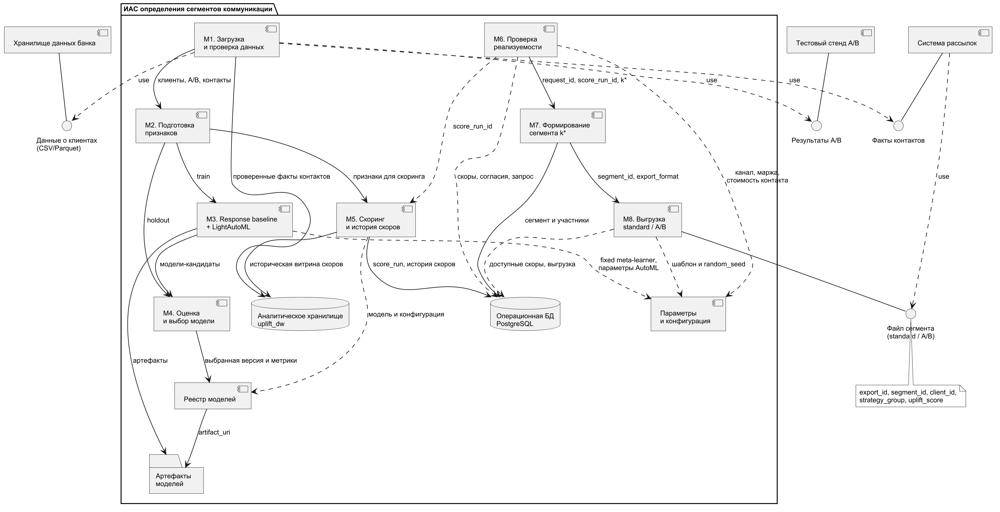
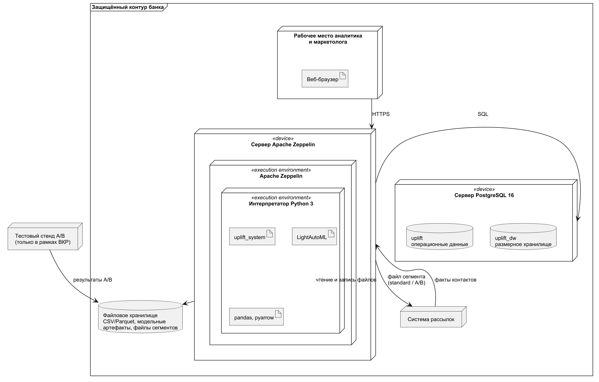
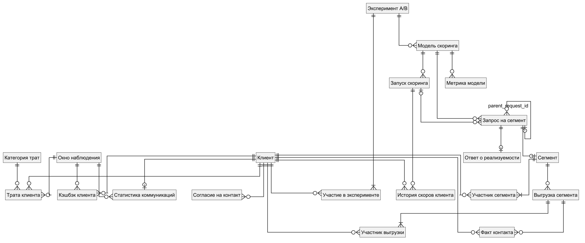
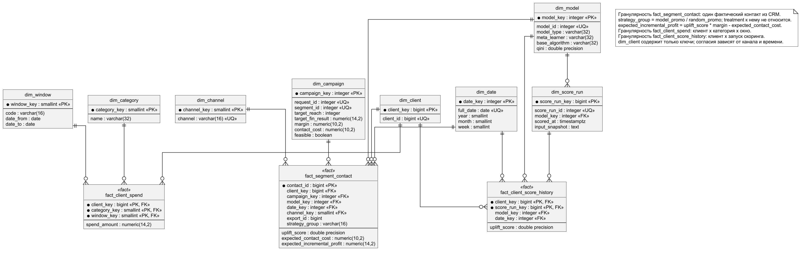

# Архитектура системы

Диаграммы построены в главе 2 ВКР (нотации UML, DFD, модели данных);
здесь — ключевые, полный комплект из 23 рисунков — в тексте работы.

## Компонентная диаграмма

Шесть модулей соответствуют этапам пайплайна: данные → эксперимент →
модели → оценка → сегменты → проверки.

## Диаграмма развёртывания

Узлы: СУБД PostgreSQL 16 (операционная схема `uplift` и витрина `uplift_dw`),
аналитический контур (Zeppelin), исполняемый пакет `uplift-system`.
Внешние зависимости подключаются файловыми контрактами —
см. [EXTERNAL_INTEGRATIONS.md](EXTERNAL_INTEGRATIONS.md).

## Модель данных

ER-диаграмма операционной схемы `uplift`:

Витрина `uplift_dw` (звезда) для отчётности:

DDL обеих схем (PostgreSQL 16) — [`db/001_init.sql`](../db/001_init.sql),
применяется автоматически при `docker compose up`.
